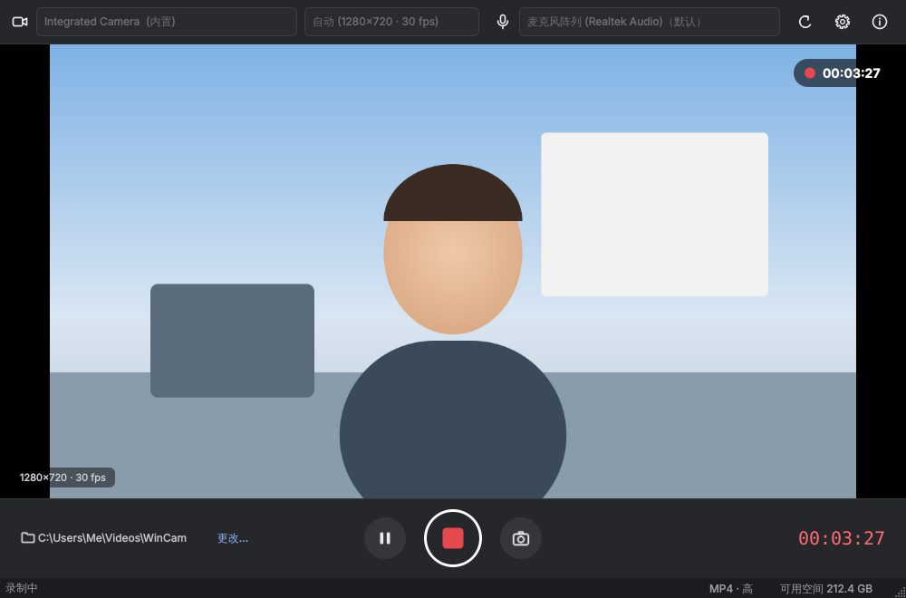

# WinCam

简洁易用的 **Windows 10 / 11 摄像头录像软件**。支持内置摄像头和 USB 摄像头，可选麦克风、分辨率、画质和保存目录。



## 功能

- **选择摄像头**：自动列出所有摄像头（笔记本内置 / USB 外接），插拔设备后自动刷新
- **录制质量预设**：480p 标清（默认，1.5 Mbps，约 12 MB/分钟）、720p 高清（4 Mbps）、1080p 全高清（8 Mbps）；选“自定义…”可在设置里精确指定分辨率/帧率、码率和画质
- **选择麦克风**：任意录音设备，或“不录制声音”；可调录音音量
- **保存目录**：默认 `视频\WinCam`，一键打开或更改；文件名自动按时间命名，例如 `WinCam_20261015_143012.mp4`
- **录完自动打开文件夹**：录制结束后自动打开保存目录并选中刚录好的视频（可在设置中关闭）
- **右下角托盘图标和通知**：程序运行时右下角有 WinCam 图标（录制中变红点、暂停变黄色），右键可开始/停止录制、拍照、打开文件夹、退出；窗口最小化、录像保存完成时屏幕右下角会弹出提示卡片，后台录制时卡片常驻并实时显示录制时长（可一键恢复窗口或停止录制）；录制时任务栏标题显示“● 录制中 00:01:23”
- **录制控制**：开始 / 停止、暂停 / 继续、录制中拍照，显示录制时长
- **设置**
  - 文件格式（MP4 / MKV / AVI 等，按本机支持情况列出）、视频编码、音频编码
  - 录制前倒计时（3 / 5 / 10 秒）
  - 定时自动停止录制
  - 镜像预览（像照镜子，不影响录制文件）
  - 照片格式 JPG / PNG
  - 最小化时隐藏到托盘、通知开关、窗口置顶
  - 界面语言：简体中文 / English
- **安全保护**：磁盘空间不足时拒绝开始或自动停止；录制中关闭窗口会先确认，并等待文件写完再退出

## 快捷键

| 按键 | 作用 |
| --- | --- |
| F9 | 开始 / 停止录制 |
| F10 | 暂停 / 继续 |
| F8 | 拍照 |
| F11 或双击画面 | 全屏 / 退出全屏 |
| Ctrl + , | 打开设置 |

## 下载与安装

在 GitHub 仓库的 **Actions** 页面打开最新一次 “Build Windows” 运行，下载 `WinCam-x.y.z-windows` 压缩包；或在 **Releases** 页面下载正式版本。里面有两个文件：

- `WinCam-x.y.z-Setup.exe`：安装版，双击安装，会创建开始菜单和桌面快捷方式
- `WinCam-x.y.z-portable.zip`：免安装版，解压后运行 `WinCam.exe`

> 便携使用：在 `WinCam.exe` 同目录下新建一个空文件 `wincam.ini`，设置就会保存在这个文件里，而不是注册表。

### 常见问题

- **看不到摄像头 / 画面黑屏**：打开 Windows 设置 → 隐私和安全性 → 相机，开启“允许桌面应用访问相机”；并关闭其他正在使用摄像头的程序（微信、Teams、Zoom 等）。
- **右下角找不到 WinCam 托盘图标**：Windows 11 默认把新的托盘图标收在右下角“^”里。可以把它拖到任务栏上，或在 设置 → 个性化 → 任务栏 → 其他系统托盘图标 中打开 WinCam。最小化提示和保存提示是 WinCam 自己画的卡片，不受这个设置影响。
- **Windows 提示“已保护你的电脑”**：程序没有数字签名。点“更多信息” → “仍要运行”即可。
- **没有声音**：检查顶部麦克风是否选择了正确设备，以及 Windows 设置 → 隐私和安全性 → 麦克风 权限。

## 从源码运行 / 开发

需要 Python 3.10+：

```bash
pip install -r requirements-dev.txt
python -m wincam          # 运行
python -m pytest          # 测试
pyinstaller wincam.spec   # 在 Windows 上打包到 dist/WinCam/
```

技术栈：Python + PySide6（Qt 6 Multimedia，Windows 上使用 FFmpeg / Media Foundation 后端），PyInstaller 打包，Inno Setup 制作安装程序。每次推送代码，GitHub Actions 会在 Windows 机器上自动测试、打包；推送 `v*` 标签（如 `v1.0.0`），或在 Actions 页面手动运行 “Build Windows” 并勾选 “Publish a GitHub release”，会自动发布 Release（版本号取自 `wincam/__init__.py`）。

### 项目结构

```
wincam/
  app.py              程序入口、深色主题
  main_window.py      主窗口（设备选择、预览、录制控制）
  capture.py          摄像头 / 麦克风 / 录制封装
  settings_dialog.py  设置对话框
  widgets.py          预览画面、录制按钮
  config.py           设置持久化
  i18n.py             中英文文字
  icons.py            界面图标（代码绘制）
  resources/          应用图标
installer/wincam.iss  安装程序脚本
wincam.spec           PyInstaller 打包配置
```
